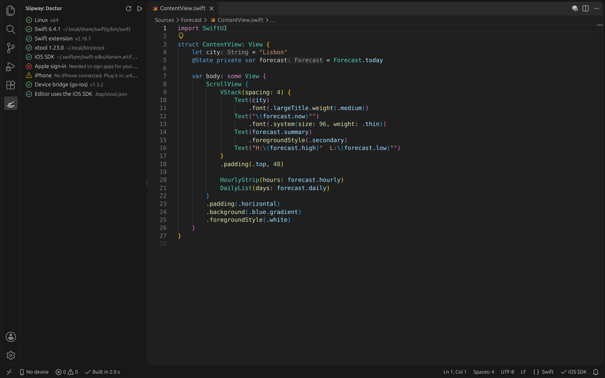
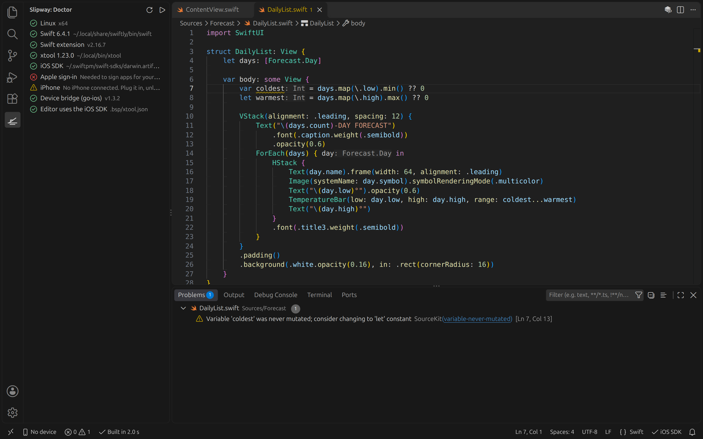

# Slipway

**Build and run SwiftUI iPhone apps on Windows and Linux, in VS Code. No Mac required.**

Slipway puts [xtool](https://github.com/xtool-org/xtool) inside VS Code and handles
everything around it: setup, the build, your phone, the logs and the free Apple ID
limits. You write SwiftUI, press Run, and the app opens on your iPhone.

> **Early preview.** Setup, templates, building and iOS code completion are tested on
> Ubuntu. Running on an iPhone and the Windows setup are built but not yet tested on real
> hardware. Reports are welcome on [GitHub](https://github.com/0xSteph/slipway/issues).

## Features

- **Doctor** checks Swift, xtool, the iOS SDK, Apple sign-in, your iPhone and Developer Mode, with a fix for each.
- **Build** puts compiler errors and warnings in the Problems panel. A one-line change rebuilds in about 2 seconds.
- **iOS code completion** through the official Swift extension.
- **Run** builds, signs, installs and launches the app, and streams its log into a panel.
- **Crash reports** are pulled off the phone and opened when the app crashes.
- **Free Apple ID tools:** a 7-day countdown, one-click Refresh, an App ID counter and warnings for paid-only capabilities.
- **New iOS App** templates that build on Linux, including a Local Notifications starter.
- **Windows setup guide** for WSL and Apple Devices, then automatic iPhone detection from WSL.

## Get started

1. **Windows:** install WSL with Ubuntu (`wsl --install -d Ubuntu-24.04`), Apple Devices from the Microsoft Store, and VS Code's WSL extension. Open the Slipway panel; it guides you through the rest and reopens your project in WSL.
2. **In Linux or WSL:** install Swift 6.4 from [swift.org](https://www.swift.org/install/linux/) and [xtool](https://github.com/xtool-org/xtool).
3. Follow the **Doctor**: download Xcode from Apple (Slipway only uses its iOS SDK), install the SDK and sign in to Apple in the terminal it opens.
4. Run **Slipway: New iOS App**, plug in your iPhone and press **Run**.

## Before you sign in

Since September 2026 Apple has refused to sign apps for some free developer accounts,
across AltStore, SideStore and similar tools. Reports say the Apple ID itself keeps
working, but nobody outside Apple knows the trigger. **Use a secondary Apple ID** for
signing; your iPhone can stay on your main iCloud account. Slipway never sees your
password: you type it into xtool.

## Requirements

Windows 11 with WSL 2, or Ubuntu 24.04+ · VS Code 1.93+ · Swift 6.4 · xtool 1.23+ ·
Xcode downloaded by you, for its SDK · an Apple ID · an iPhone (launch needs iOS 17.4.1+
or iOS 16 and earlier).

Full guide, FAQ and roadmap: [github.com/0xSteph/slipway](https://github.com/0xSteph/slipway).

---

Apple, iPhone, iCloud, Mac, macOS and Xcode are trademarks of Apple Inc. Visual Studio Code and Windows
are trademarks of Microsoft Corporation. Slipway is an independent project and is not affiliated with, or
endorsed by, Apple or Microsoft.
