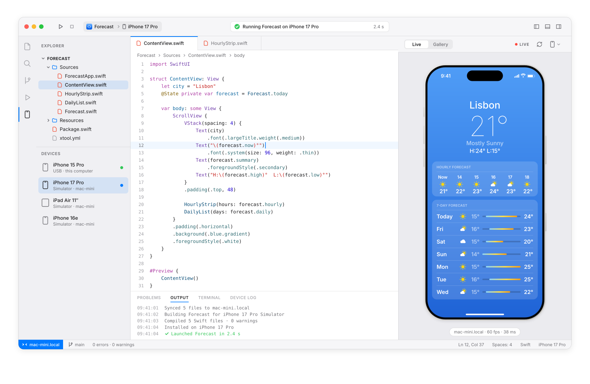
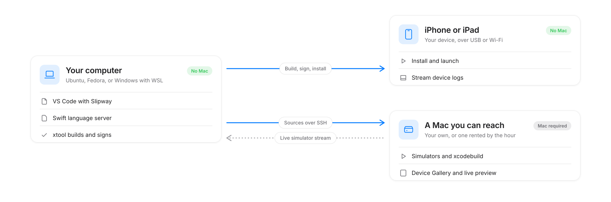

<picture>
  <source media="(prefers-color-scheme: dark)" srcset="docs/assets/header-dark.svg">
  
</picture>

[How it works](#how-it-works) · [Roadmap](#roadmap) · [FAQ](#faq)

> [!NOTE]
> **Slipway is in design.** Nothing below ships yet. The images are concept renders
> of the planned extension, and the [roadmap](#roadmap) shows what gets built in what
> order. Watch the repo to follow along.

<picture>
  <source media="(prefers-color-scheme: dark)" srcset="docs/assets/hero-dark.svg">
  
</picture>

Concept render.

You can write Swift on any computer. Until recently, you could only build an iPhone
app on a Mac. [xtool](https://github.com/xtool-org/xtool) changed that: it builds,
signs and installs iOS apps from Linux and Windows. Slipway puts that inside VS Code,
and adds a real Simulator whenever you can reach a Mac.

## Run on your iPhone. No Mac.

Press Run. Slipway builds your SwiftUI app with xtool, signs it with your Apple ID,
installs it over USB or Wi-Fi, and streams the device log into the Output panel.
Compiler errors land in Problems. Completion and diagnostics come from the official
Swift extension, so editing feels like any other language in VS Code.

## Every screen size at once

Connect a Mac, your own or one rented by the hour, and the Device Gallery renders
your app on iPhone and iPad simulators side by side.

<picture>
  <source media="(prefers-color-scheme: dark)" srcset="docs/assets/devices-dark.svg">
  
</picture>

Concept render.

## A live Simulator in a panel

The Simulator streams into VS Code. Click to tap, type to type. Save a file and
Slipway rebuilds and relaunches the app.

## How it works

<picture>
  <source media="(prefers-color-scheme: dark)" srcset="docs/assets/flow-dark.svg">
  
</picture>

Everything that can run on your computer does. The Simulator is the exception: it is
built from macOS itself, and Apple's license ties macOS to Apple hardware. So Slipway
doesn't fake it. It reaches a real Mac over SSH and streams the Simulator back.

## Roadmap

| Phase | What you get | Status |
|:--|:--|:--|
| 0 | Proof: xtool builds a SwiftUI app on Linux and installs it on an iPhone | **Next** |
| 1 | Setup assistant, new-app templates, Build, Run on device, device logs | Planned |
| 2 | Bring your own Mac over SSH, Device Gallery | Planned |
| 3 | Live Simulator panel with touch input, rebuild on save | Planned |
| 4 | Hosted Macs, for when you don't have one at all | Planned |

## What you'll need

- VS Code on Linux, or on Windows with WSL.
- An Apple ID. A free one runs apps on your own devices; TestFlight and the App Store
  need the Apple Developer Program.
- Xcode, downloaded by you from Apple. Slipway never redistributes it.
- For the Simulator, a Mac you can reach over SSH.

## FAQ

<b>Is this allowed?</b>

 

Slipway is designed around Apple's terms. You download Xcode with your own Apple ID,
Slipway never ships Apple's SDK, and the Simulator only ever runs on real Mac hardware.
Building on Linux with the SDK from your Xcode download is a grey area under Apple's
license, and we'd rather tell you that up front. The Mac-backed path doesn't depend on it.

<b>Does it replace Xcode?</b>

 

No. Interface Builder, storyboards and Instruments stay on the Mac. Slipway covers the
SwiftUI loop: edit, build, run, preview.

<b>Can I ship to the App Store?</b>

 

That's planned through the App Store Connect API, after the phases above.

<b>Why not just rent a Mac?</b>

 

You can, and Slipway will use it. The difference is that you keep your own computer
and your own editor, and the Mac becomes a resource you call on instead of a
machine you sit at.

## Built on

- [xtool](https://github.com/xtool-org/xtool) by Kabir Oberai (MIT): builds, signs and installs without Xcode.
- [Swift for Visual Studio Code](https://github.com/swiftlang/vscode-swift) and SourceKit-LSP (Apache 2.0): editing and diagnostics.
- [Inter](https://rsms.me/inter/) and [JetBrains Mono](https://www.jetbrains.com/lp/mono/) (OFL): the type in the artwork.

## Contributing

It's early, and design feedback is the most useful thing right now. Open an issue
with what you'd want from iOS development off the Mac. Repo conventions are in
[AGENTS.md](AGENTS.md).

## License

[MIT](LICENSE)

Apple, iPhone, iPad, Mac, macOS and Xcode are trademarks of Apple Inc., registered in the U.S.
and other countries. Visual Studio Code is a trademark of Microsoft Corporation. Slipway is an
independent project and is not affiliated with, or endorsed by, Apple or Microsoft.
