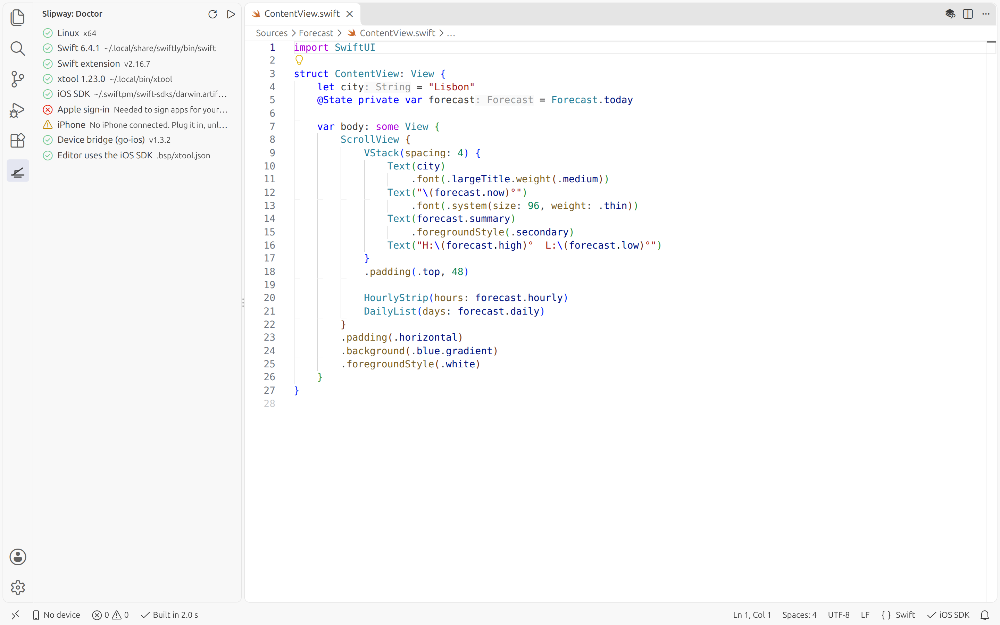
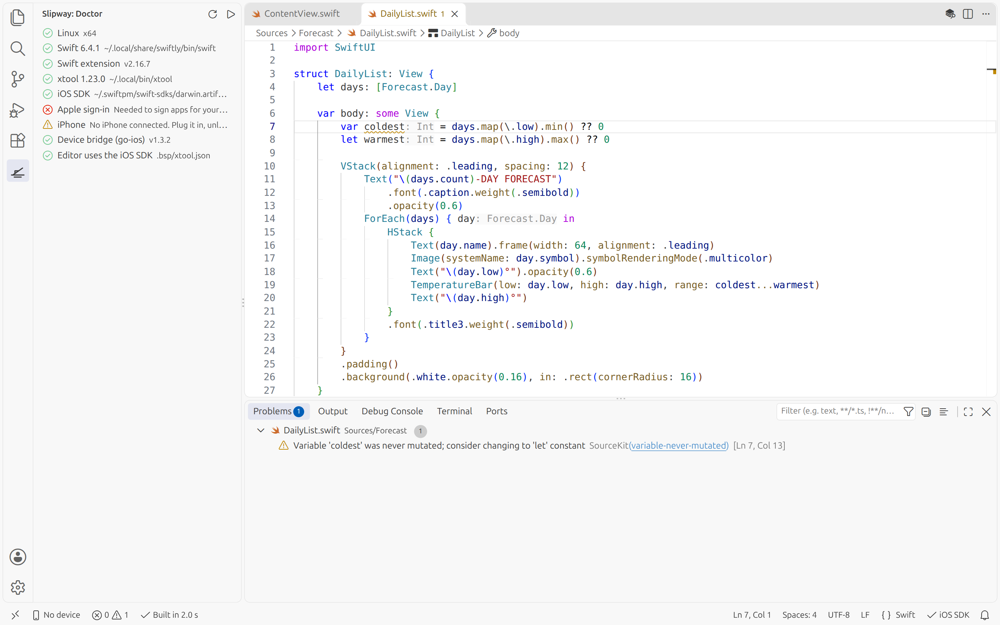
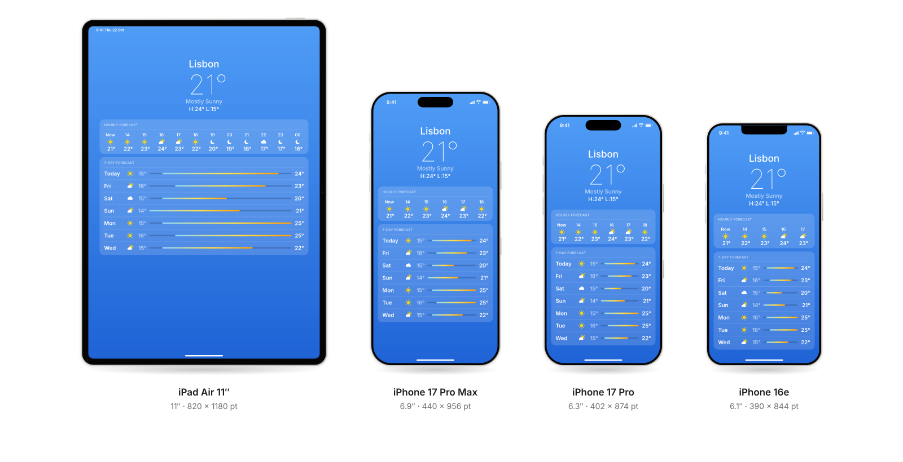

<div align="center">

<picture>
  <source media="(prefers-color-scheme: dark)" srcset="docs/assets/header-dark.svg">
  
</picture>

**Build and run SwiftUI iPhone apps on Windows and Linux, in VS Code. No Mac required.**

[](LICENSE)
[%20%C2%B7%20Linux-informational)](#quick-start)
[](https://code.visualstudio.com/)
[](#status)

[Quick start](#quick-start) · [Features](#features) · [How it works](#how-it-works) · [FAQ](#faq) · [Roadmap](#roadmap)

</div>

<picture>
  <source media="(prefers-color-scheme: dark)" srcset="docs/assets/screenshots/doctor-build-dark.png">
  
</picture>
<p align="center"><sub>A real screenshot: Slipway's Doctor and a SwiftUI build on Ubuntu.</sub></p>

For years, making an iPhone app meant buying a Mac. [xtool](https://github.com/xtool-org/xtool)
changed that. It builds, signs and installs iOS apps from Linux and Windows. Slipway
puts it inside VS Code and takes care of everything around it: setup, the build,
your phone, the logs, the free-account limits.

You write SwiftUI, press Run, and the app opens on your iPhone.

> [!IMPORTANT]
> <a id="status"></a>**Slipway is an early preview.** Setup, templates, building and iOS code
> completion are tested on Ubuntu. Running on an iPhone (install, launch, live logs, crash
> reports) is built but **has not been tested on a real device yet**, and the Windows setup
> is built but not yet tested on a Windows PC. If you try either, please
> [tell us how it went](https://github.com/0xSteph/slipway/issues/new/choose). See [Status](#what-works-today).

## Why Slipway

- Build SwiftUI apps on the Windows or Linux computer you already have. You don't need a Mac.
- Write the same Swift and SwiftUI you would in Xcode. If you get a Mac later, xtool runs there too and can generate an Xcode project.
- Start for free. A free Apple ID is enough to run your app on your own iPhone.
- Stay in VS Code for completion, errors and the build.
- Let the Doctor panel check each part of the setup and offer a fix for anything missing.

## Quick start

You need a computer with Windows 11 or Ubuntu, VS Code, an iPhone and a USB cable.
Most of the first-time setup is waiting for Xcode to download (about 2 GB).

<details open>
<summary><b>Windows</b></summary>
<br>

Slipway's tools run in WSL, the Linux that ships with Windows. VS Code connects to it,
so it feels like any other project.

1. **Install WSL with Ubuntu.** In an administrator PowerShell run `wsl --install -d Ubuntu-24.04`, then restart.
2. **Install [Apple Devices](https://apps.microsoft.com/search?query=Apple%20Devices)** from the Microsoft Store. It's Apple's free iPhone driver. Plug in your iPhone, unlock it and tap **Trust**.
3. **Install VS Code** with the [WSL extension](https://marketplace.visualstudio.com/items?itemName=ms-vscode-remote.remote-wsl) and Slipway.
4. **Open the Slipway panel.** On Windows it walks you through the rest: it can switch on WSL's mirrored networking (so WSL can reach your iPhone through Apple Devices) and reopen your project inside WSL.
5. Continue with **Inside Linux or WSL** below.

USB passthrough with [usbipd-win](https://learn.microsoft.com/windows/wsl/connect-usb) also works, and Slipway detects either.
</details>

<details open>
<summary><b>Inside Linux or WSL</b></summary>
<br>

1. **Install Swift 6.4** from [swift.org/install](https://www.swift.org/install/linux/) (swiftly is the easiest way).
2. **Install xtool:**
   ```sh
   mkdir -p ~/.local/bin && curl -fL "https://github.com/xtool-org/xtool/releases/latest/download/xtool-$(uname -m).AppImage" -o ~/.local/bin/xtool && chmod +x ~/.local/bin/xtool
   ```
3. **Open the Slipway panel** in VS Code and follow the Doctor:
   - **Get the iOS SDK.** Download Xcode from Apple with your own Apple ID, then click *Install SDK*. xtool extracts just the iOS SDK in about a minute.
   - **Sign in to Apple.** A terminal opens and you type your Apple ID into xtool. Slipway never sees your password. [Use a secondary Apple ID](#will-i-get-banned-is-my-apple-id-safe).
4. **Create an app:** run **Slipway: New iOS App** from the Command Palette.
5. **Press Run** in the status bar, or <kbd>Ctrl</kbd>+<kbd>Alt</kbd>+<kbd>R</kbd>.
</details>

## Features

<picture>
  <source media="(prefers-color-scheme: dark)" srcset="docs/assets/screenshots/problems-dark.png">
  
</picture>
<p align="center"><sub>Warnings and errors land in the Problems panel, with live diagnostics against the iOS SDK.</sub></p>

**Doctor.** It checks Swift, xtool, the iOS SDK, your Apple
sign-in, the phone, Developer Mode and the device tools. Every red row says what's wrong
in one sentence and has a fix.

**Fast builds.** The first build of a new app takes under a minute. After that, a
one-line change rebuilds in about 2 seconds (measured on a 16-thread Ubuntu desktop).
Errors and warnings land in the Problems panel on the right line.

**iOS code completion.** With the official Swift extension, completion and live errors
use the iOS SDK, so `UIApplication` and SwiftUI resolve like they do in Xcode.

**Run on your iPhone.** One button builds, signs, installs and launches the app, then
streams its log into the *Slipway: Device Log* panel. Press Stop to quit it.

**Crash reports.** If the app crashes, Slipway pulls the report off the
phone and opens it.

**Free Apple ID tools.** Apps signed with a free account stop opening after 7 days. Slipway counts down,
reminds you, and Refresh reinstalls without rebuilding. It warns before you use up
one of the 10 App IDs a free account gets each week, and tells you when a capability
like Push Notifications needs a paid account.

**Templates.** Both build on Linux: a SwiftUI starter, and a Local Notifications starter
that shows banners and badges on a free account without a push server.

**Windows setup.** On Windows, Slipway checks WSL, Apple Devices and WSL's networking
mode, with a fix for each, then finds your iPhone from WSL by itself.

**Redacted diagnostics.** *Collect Diagnostics* writes a report with your Apple ID,
team ID, device IDs and home folder removed.

### What works today

| Feature | Status |
|:--|:--|
| Doctor, templates, Build, Problems panel, iOS code completion | Tested on Ubuntu |
| Run on iPhone: install, launch, device log, Stop, crash reports | Built, needs device testing |
| Free-account tools: expiry, Refresh, App ID count, capability warnings | Built, needs device testing |
| Windows: setup guide, iPhone connection from WSL | Built, needs Windows testing |
| macOS host | Not a target. On a Mac, use Xcode. |

## How it works

Slipway coordinates several tools, each doing one job:

| Step | Done by |
|:--|:--|
| Edit, complete, show errors | VS Code and the [Swift extension](https://github.com/swiftlang/vscode-swift) (SourceKit-LSP) |
| Compile for iOS | Swift 6.4 with the iOS SDK from **your own** Xcode download, via xtool |
| Sign and install | [xtool](https://github.com/xtool-org/xtool), with your Apple ID |
| Launch, logs, crash reports | [go-ios](https://github.com/danielpaulus/go-ios), downloaded on first use and checked against a pinned SHA-256 |
| Setup, status, free-account limits | Slipway |

On iOS 17 and later, launching an app from a computer needs Apple's developer disk image
on the phone. Slipway asks before go-ios downloads it, and you can point it at your own
copy instead. Nothing from Apple is bundled with Slipway.

## Requirements

- Windows 11 with WSL 2, or Ubuntu 24.04 or later (tested on 26.04). Other Linux distributions that run Swift 6.4 should work.
- VS Code 1.93 or later. Cursor, VSCodium and other VS Code-based editors should work too.
- Swift 6.4 and xtool 1.23 or later.
- Xcode, downloaded by you from Apple, only for its iOS SDK. You never run it.
- An Apple ID. A free one runs apps on your own devices. TestFlight and the App Store need the Apple Developer Program.
- An iPhone and a USB cable. Slipway launches apps on iOS 17.4.1 or later and on iOS 16 or earlier. On iOS 17.0 to 17.4 the app installs and you open it yourself.

## FAQ

<details>
<summary><b>Do I really not need a Mac?</b></summary>
<br>

Not for building, signing and running on your iPhone. You do download Xcode once, on any
computer, because the iOS SDK ships inside it. The iOS Simulator is the one thing that
only runs on macOS, which is why Simulator support is on the roadmap as "bring your own Mac".
</details>

<details>
<summary><b>Is it free?</b></summary>
<br>

Yes. Slipway, xtool, go-ios and Swift are free and open source, and a free Apple ID can
run apps on your own iPhone. Apple's Developer Program ($99 a year) is only needed for
TestFlight, the App Store and capabilities like push notifications.
</details>

<details>
<summary id="will-i-get-banned-is-my-apple-id-safe"><b>Will I get banned? Is my Apple ID safe?</b></summary>
<br>

Read this before you sign in. Since September 2026 Apple has been refusing to sign apps
for some **free** developer accounts. People using AltStore, SideStore and Sideloadly
have hit it. The error says the provisioning profile is banned. Reports say the Apple ID
itself, with its iCloud data and purchases, keeps working; only app signing stops. Nobody
outside Apple knows what triggers it, and Slipway can't promise it won't happen to you.

What we recommend:

- **Sign in to xtool with a secondary Apple ID.** Your iPhone can stay signed in to your
  main iCloud account; xtool only uses the Apple ID you give it.
- If your main Apple ID holds data you can't afford to lose, don't use it with any
  sideloading tool, including this one.
- A paid Apple Developer Program account is Apple's supported route.

If signing is refused, Slipway shows what happened and what your options are.
</details>

<details>
<summary><b>Is this allowed?</b></summary>
<br>

Slipway is designed around Apple's terms. You download Xcode with your own Apple ID,
Slipway never ships Apple's SDK, and any future Simulator support runs only on real Mac
hardware. Building on Linux with the SDK from your Xcode download is a grey area under
Apple's license, and we'd rather tell you that up front.
</details>

<details>
<summary><b>Does it replace Xcode?</b></summary>
<br>

For the SwiftUI loop of edit, build and run, it aims to. Interface Builder, storyboards,
asset catalogs and Instruments stay on the Mac. Asset catalogs don't compile on Linux
yet, so Slipway's templates use a single PNG icon, and it can convert an existing AppIcon for you.
</details>

<details>
<summary><b>Does it work on Windows without WSL?</b></summary>
<br>

No. The Swift toolchain and xtool run on Linux, so on Windows they run in WSL. VS Code's
WSL extension makes that feel local: you open the folder, and Slipway runs on the Linux side.
</details>

<details>
<summary><b>Can I publish to the App Store?</b></summary>
<br>

Not yet. TestFlight upload through the App Store Connect API is on the roadmap. It
will need a paid developer account.
</details>

<details>
<summary><b>Does Slipway collect data?</b></summary>
<br>

No. There's no telemetry. Slipway itself downloads two things, once each: go-ios from
GitHub and Apple's root certificate from apple.com. Everything else that talks to Apple
goes through xtool and go-ios, when you sign in, sign an app or prepare a phone.
</details>

## Roadmap

| Version | What you get | Status |
|:--|:--|:--|
| **0.1** | Doctor, templates, Build, Run on iPhone, device log, crash reports, free-account tools, Windows setup | Early preview, testing |
| **0.2** | `slipway` command-line tool for any editor and CI, "Send test push" to your iPhone (paid account), MCP server for AI assistants | Planned |
| **Phase 2** | Bring your own Mac over SSH: Simulator and a gallery of every screen size | Planned |
| **Phase 3** | Live Simulator in a VS Code panel, rebuild on save | Planned |
| **Phase 4** | Hosted Macs, for when you don't have one at all | Planned |

<details>
<summary>Concept art for the Mac-backed phases</summary>
<br>

<picture>
  <source media="(prefers-color-scheme: dark)" srcset="docs/assets/devices-dark.svg">
  
</picture>
<p align="center"><sub>Concept render of the Phase 2 Device Gallery. Not built yet.</sub></p>
</details>

## Help test it

The fastest way to help is to try Slipway and report back:

- **iPhone testers:** run the Local Notifications template and tell us your iOS version and what happened.
- **Windows testers:** follow the Windows quick start and tell us where it got stuck.

Open an issue with the report from **Slipway: Collect Diagnostics** attached. It's redacted
by default. Code contributions are welcome too; see [CONTRIBUTING.md](CONTRIBUTING.md).

If Slipway is useful to you, a star helps other people find it.

## Built on

- [xtool](https://github.com/xtool-org/xtool) by Kabir Oberai (MIT): builds, signs and installs iOS apps without a Mac.
- [go-ios](https://github.com/danielpaulus/go-ios) by Daniel Paulus (MIT): launch, logs and crash reports on current iOS.
- [Swift for Visual Studio Code](https://github.com/swiftlang/vscode-swift) and SourceKit-LSP (Apache 2.0): editing and diagnostics.
- [Inter](https://rsms.me/inter/) and [JetBrains Mono](https://www.jetbrains.com/lp/mono/) (OFL): the type in the artwork.

## License

[MIT](LICENSE)

<sub>Apple, iPhone, iPad, iCloud, Mac, macOS, TestFlight and Xcode are trademarks of Apple Inc., registered
in the U.S. and other countries. Visual Studio Code and Windows are trademarks of Microsoft Corporation.
Slipway is an independent project and is not affiliated with, or endorsed by, Apple or Microsoft.</sub>
